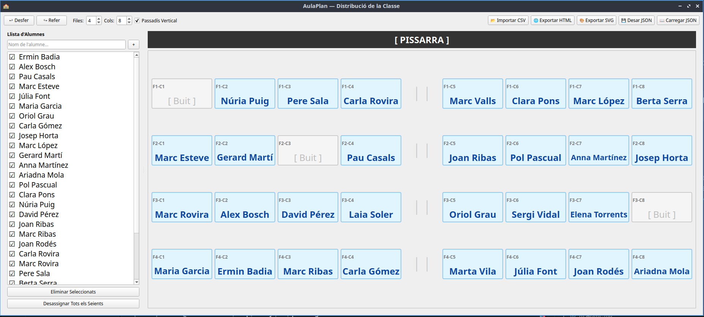

# 🏫 AulaPlan — Distribució i Gestió de la Classe

**AulaPlan** és una aplicació d'escriptori desenvolupada en Python i Tkinter per a la gestió visual, intuïtiva i flexible de la distribució d'alumnes a l'aula. Permet als docents organitzar els seients mitjançant l'arrossegament i soltada (*drag & drop*), configurar les mides de la graella, afegir un passadís personalitzat i exportar el resultat en múltiples formats.

---


## 🚀 Característiques Principals

- **Visualització d'Aula Interactiva**:
  - Interfície adaptada a la mida de la classe amb vista de la pissarra a la part superior.
  - Targetes de seient grans i llegibles amb identificació de fila i columna (ex: `F1-C2`).
  - Indicació clara dels seients ocupats i lliures.

- **Funció Arrossegar i Soltar (*Drag & Drop*)**:
  - Assigna alumnes des de la llista lateral cap a qualsevol seient buit.
  - Intercanvia alumnes de posició arrossegant-los entre seients.
  - Desassigna un alumne arrossegant-lo des del seu seient de tornada a la llista lateral.

- **Feedback Visual de Destacat (Highlight)**: Cada vegada que es col·loca o mou un alumne de seient, es destaca automàticament en color blau intens durant 1 segon tant a la llista lateral com a la taula assignada.

- **Control del Passadís Vertical**: Permet activar i personalitzar un passadís vertical a la graella de l'aula. Des del fitxer de configuració es pot indicar la seva posició entre les columnes. 

- **Configuració Dinàmica de la Graella**:
  - Nombre personalitzable de files i columnes (de 1 a 10).
  - **Passadís Vertical Ajustable**: Opció per afegir un passadís central o personalitzat (`vertical_aisle_after`), al fitxer de configuració, per dividir blocs de taules.

  - **Gestió Multi-selecció d'Alumnes**: Selecció múltiple d'alumnes a la llista lateral (fent servir Ctrl o Shift) per eliminar diversos registres a la vegada, amb diàleg de confirmació prèvia.

- **Gestió d'Històrial (Desfer / Refer)**:
  - Botons ↩ **Desfer** i ↪ **Refer** per revertir o recuperar qualsevol canvi en la distribució o en la llista d'alumnes.

- **Càrrega Automàtica de Configuració**:
  - En iniciar, l'aplicació detecta i carrega automàticament el fitxer `config_default.json` si existeix al mateix directori.

- **Exportació i Importació**:
  - **Importació CSV**: Carrega llistes d'alumnes ràpidament des de fitxers `.csv`.
  - **JSON**: Guarda i carrega l'estat complet de l'aula (mides, llista d'alumnes i posicions).
  - **SVG Vectorial**: Exporta la distribució en format `.svg` d'alta resolució apte per a impressió o modificació gràfica.
  - **HTML**: Genera una pàgina web interactiva i dissenyada per ser impresa directament.

## Requisits

- Python 3.10 o posterior.
- `pip` i `venv` (normalment inclosos amb Python).
- Linux o Windows per executar l'aplicació.

No cal instal·lar dependències addicionals per al model o l'emmagatzematge: les
dependències externes de l'aplicació són PyQt6 i, per crear l'executable,
PyInstaller.

## Preparar l'entorn de desenvolupament

Obriu un terminal a la carpeta del projecte.

### Linux

```bash
python3 -m venv .venv
source .venv/bin/activate
python -m pip install --upgrade pip
python -m pip install PyQt6 PyInstaller
python main.py
```

Per sortir de l'entorn virtual:

```bash
deactivate
```

### Windows (PowerShell)

```powershell
py -3 -m venv .venv
.\.venv\Scripts\Activate.ps1
python -m pip install --upgrade pip
python -m pip install PyQt6 PyInstaller
python main.py
```

Si PowerShell no permet activar l'entorn virtual, també podeu executar les
ordres amb el Python de l'entorn sense activar-lo:

```powershell
.\.venv\Scripts\python.exe -m pip install --upgrade pip
.\.venv\Scripts\python.exe -m pip install PyQt6 PyInstaller
.\.venv\Scripts\python.exe main.py
```

## Crear una aplicació per a Linux

Des de la carpeta del projecte, executeu l'script inclòs:

```bash
./package_linux.sh
```

L'script crea l'entorn `.venv-build`, hi instal·la PyInstaller i PyQt6, i
empaqueta `config_default.json` dins de l'aplicació. El fitxer executable es
desa a:

```text
dist/AulaPlan
```

Si el sistema de fitxers no conserva el permís d'execució de l'script, feu-lo
executable abans:

```bash
chmod +x package_linux.sh
```

Podeu executar l'aplicació amb:

```bash
./dist/AulaPlan
```

## Crear una aplicació per a Windows

PyInstaller no és un compilador creuat: l'executable de Windows s'ha de crear
des de Windows. Obriu PowerShell a la carpeta del projecte i executeu:

```powershell
py -3 -m venv .venv-build
.\.venv-build\Scripts\Activate.ps1
python -m pip install --upgrade pip
python -m pip install PyQt6 PyInstaller
pyinstaller --clean --noconfirm --onefile --windowed --name AulaPlan --add-data "config_default.json;." main.py
```

L'executable es crearà a:

```text
dist\AulaPlan.exe
```

Per distribuir-lo, copieu `dist\AulaPlan.exe` a l'ordinador Windows de destí.
Feu la compilació al sistema operatiu i a l'arquitectura de destinació: un
paquet creat per a Windows no serveix a Linux, ni a l'inrevés. En particular,
els binaris de Linux poden dependre de les biblioteques del sistema instal·lades
a l'ordinador on s'executin.

## Fitxers del projecte

- `main.py`: interfície gràfica i lògica d'interacció.
- `model.py`: model de dades de l'aula i dels alumnes.
- `storage.py`: importació i exportació de dades i plans.
- `config_default.json`: configuració inicial carregada en iniciar l'aplicació.
- `package_linux.sh`: script per empaquetar l'aplicació a Linux.
